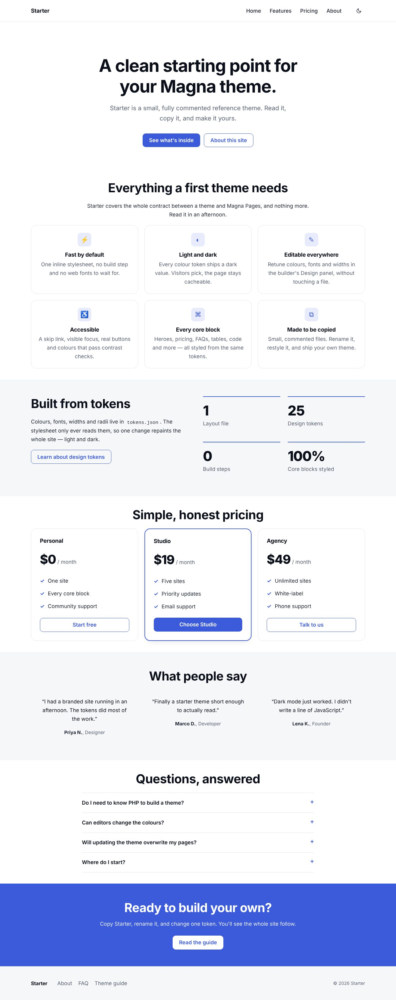
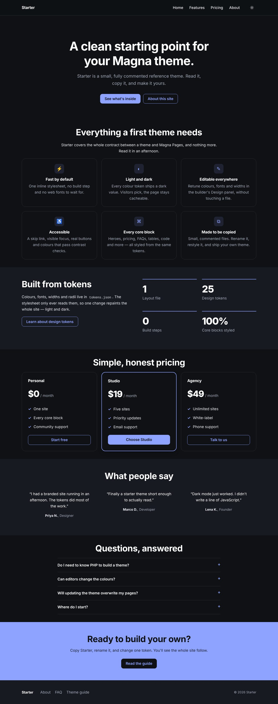

<h1 align="center">Magna Theme Starter Kit</h1>

<p align="center">
  Everything you need to build a theme for <strong>Magna Pages</strong>: a commented reference theme,<br>
  a step-by-step guide, a block reference generated from source, and tools that check your work before a site does.
</p>

<p align="center">
  <a href="LICENSE"></a>
  
  
  
  <a href="https://github.com/Magna-CMS/Magna-Theme-Starter-Kit/actions/workflows/ci.yml"></a>
</p>

<p align="center">
  
  
</p>

---

**Plugins extend Magna with code. Themes give Magna Pages its look**, and a theme is not code at
all. It is a manifest, a set of design tokens and a few Blade templates. Magna Pages renders every
page through them: in the browser, in the visual builder's canvas, and in the page cache.

This kit is the front door for theme developers. You don't need to know PHP. If you can write
HTML and CSS, you can build a Magna theme.

## What's inside

| | |
|---|---|
| 🎨 **[Starter theme](starter-theme)** | A complete, small, heavily commented theme to read and copy: one layout, 25 tokens with light and dark values, styles for every core and Magna Pages block, two example block overrides, and demo content. Passes `magna:theme:check` clean. |
| 📘 **[Developer guide](docs/README.md)** | 13 chapters, from *how Magna Pages renders a theme* to *publishing to the store*. Every behaviour checked against Magna's source and a running site. |
| 🧱 **[Block reference](docs/reference/blocks.md)** | Every block's fields, options, CSS classes, resolved data and behaviour hooks, generated from Magna's own source so it can't drift. |
| 🔍 **[`theme-lint`](tools/theme-lint.php)** | Checks a theme folder in under a second with only PHP installed. Mirrors `magna:theme:check`, plus checks for the mistakes the platform doesn't catch. |
| 🛠 **[`new-theme`](tools/new-theme.php) · [`package`](tools/package.php)** | Copy Starter under your own name; build the distributable zip. |
| 📐 **[JSON Schemas](schemas)** | Autocomplete and validation for `theme.json`, `tokens.json` and demo-content site kits. |
| 🗺 **[The plan](ROADMAP.md)** | What this kit covers, what comes next, and what we propose for Magna itself. |

## Quick start

You need a local [Magna CMS](https://github.com/Magna-CMS/Magna) site with
[Magna Pages](https://github.com/Magna-CMS/Magna-Pages) enabled. [Chapter 2](docs/02-quick-start.md)
walks through setting one up.

```bash
# 1. Get the kit
git clone https://github.com/Magna-CMS/Magna-Theme-Starter-Kit.git
cd Magna-Theme-Starter-Kit

# 2. Make your own theme from Starter
php tools/new-theme.php yourname/aurora ../aurora --display="Aurora"

# 3. Link it into your site (the folder must match the theme's name)
ln -s "$(realpath ../aurora)" /path/to/my-magna-site/themes/yourname/aurora

# 4. Check it, the way the site will
php tools/theme-lint.php ../aurora
php /path/to/my-magna-site/artisan magna:theme:check yourname/aurora
```

Then open **Admin → Themes**, activate *Aurora*, choose **Import demo content**, and visit your
site. Change `colors.primary` in `tokens.json` and reload: the whole site follows.

## How a theme works, in one picture

```
 request ─► Magna Pages ─► your views/system/layout.blade.php
                             ├─ <style>{!! $tokensCss !!}</style>      ← tokens.json, as CSS variables
                             ├─ header: site's template part, or your fallback
                             ├─ @include('magna-pages::partials.sections')
                             │     └─ each block: your views/blocks/<handle>.blade.php
                             │                    or core's default view
                             ├─ footer: site's template part, or your fallback
                             └─ popups, consent banner
```

- **Tokens** (`tokens.json`) become CSS variables. The builder's Design panel, scheduled designs,
  section overrides and dark mode all work through them. → [chapter 4](docs/04-design-tokens.md)
- **The layout** draws the shell around every page. → [chapter 5](docs/05-layout.md)
- **CSS** restyles every block through stable class names. → [chapter 6](docs/06-styling-blocks.md)
- **Block overrides** replace a block's markup when CSS can't reach. → [chapter 7](docs/07-overriding-blocks.md)
- **Demo content** makes the first minute look like your screenshot. → [chapter 8](docs/08-demo-content.md)

## Learning path

1. Read **[How Magna Pages renders a theme](docs/01-how-pages-renders.md)**: ten minutes that save hours.
2. Do the **[Quick start](docs/02-quick-start.md)**.
3. Open the Starter files side by side with chapters [3](docs/03-theme-anatomy.md)–[8](docs/08-demo-content.md).
4. Before you release, go through the **[Quality checklist](docs/11-quality-checklist.md)** and
   **[Packaging and publishing](docs/12-packaging-and-publishing.md)**.

Stuck? **[Troubleshooting](docs/13-troubleshooting.md)** covers the common problems.

## Tools

All tools need only **PHP 8.1+**. No Composer install, no Magna site.

```bash
php tools/theme-lint.php <theme-dir> [--tokens] [--strict] [--json]   # check a theme
php tools/new-theme.php <vendor/name> <target-dir> [--display=…] [--author=…]
php tools/package.php <theme-dir> [--out=dist]                        # lint, then zip
php tools/sync-blocks.php --magna=<Magna> --pages=<Magna-Pages>       # maintainers: regenerate the block reference
```

Sample `theme-lint` output:

```text
acme/aurora  /home/you/aurora
  ✖ error [core] tokens.json: Token colors.brand (value) contains ';' or '(' — refused by the injection filter at render…
  ▲ warn  [kit] views/blocks/callout.blade.php: Overrides callout without core's root class(es) magna-callout…

  1 error(s), 1 warning(s)
```

`[core]` findings are what `magna:theme:check` and Magna itself enforce. `[kit]` findings are
extra checks from this kit.

## Repository map

```
├── starter-theme/        the reference theme (install as themes/acme/starter)
├── docs/                 the developer guide, plus reference/blocks.md (generated)
├── tools/                theme-lint, new-theme, package, sync-blocks (+ data/blocks.json)
├── schemas/              JSON Schemas for theme.json, tokens.json, site kits
├── art/                  screenshots used by this README (not part of the theme)
└── .github/              CI, issue and pull-request templates
```

## Compatibility

| Kit | Magna CMS | Magna Pages |
|---|---|---|
| 1.0 | 1.6.2+ (1.7.0+ for *Import demo content*) | 0.3.0-alpha+ (0.6.0-alpha+ for *Import demo content*) |

Magna Pages is **alpha** software, and its block schemas and layout payload can change between
releases. This kit tracks them: a scheduled CI job regenerates the block reference against the
latest Magna and Magna Pages and fails when they drift.

## Related

- [Magna CMS](https://github.com/Magna-CMS/Magna): the core
- [Magna Pages](https://github.com/Magna-CMS/Magna-Pages): the page builder themes render through
- [Magna Plugin SDK](https://github.com/Magna-CMS/Magna-Plugin-SDK): for extending Magna with code
- [Eva](https://github.com/Magna-CMS/Eva-Magna-Blog-Theme): a production editorial theme to study next

## Contributing

Issues and pull requests are welcome, especially reports of anything in the guide that didn't
match what you saw. See [CONTRIBUTING.md](CONTRIBUTING.md).

## License

[MIT](LICENSE). Use the Starter theme as the base for free or commercial themes; no attribution
required.
